<!-- AllisWell: source-available tasks, notes and alarms you can host yourself. Web, iPhone, Android, Windows and Linux; an MCP connector for Claude and ChatGPT. Animations: docs/assets/readme (HyperFrames, media/hyperframes). -->

<p align="center">
  <a href="https://alliswell.space">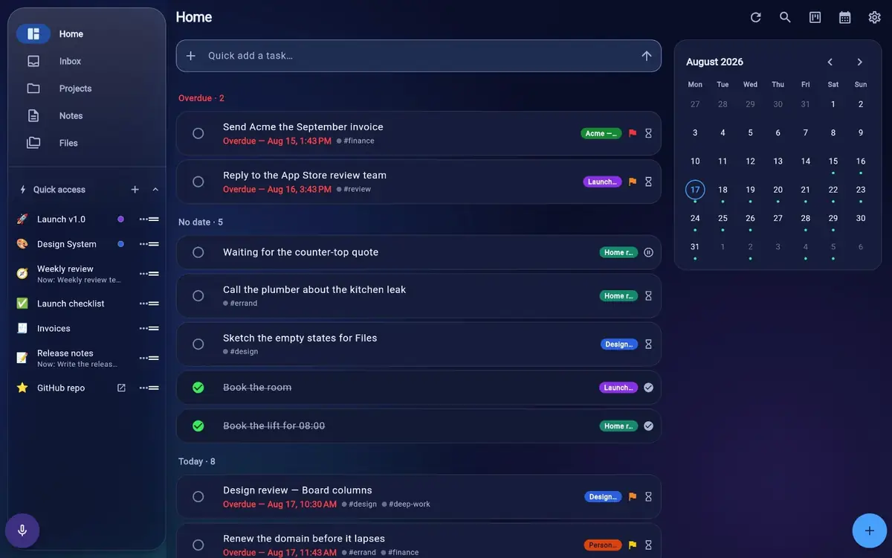</a>
</p>

<h1 align="center">AllisWell</h1>

<p align="center">
  <b>Tasks, notes and alarms you own.</b><br>
  A to-do, reminder and notes app whose urgent reminders ring through Silent mode, whose tasks sit in your Google Calendar both ways, and which runs on your own server or at <a href="https://alliswell.space">alliswell.space</a>.
</p>

<p align="center">
  <a href="https://alliswell.space/app"><b>Open the web app</b></a> &nbsp;·&nbsp;
  <a href="#see-it-in-a-minute">Watch the film</a> &nbsp;·&nbsp;
  <a href="#five-things-it-does">Features</a> &nbsp;·&nbsp;
  <a href="#use-it-from-claude-or-chatgpt">Claude and ChatGPT</a> &nbsp;·&nbsp;
  <a href="#run-it-yourself">Self-host</a> &nbsp;·&nbsp;
  <a href="#get-it">Download</a> &nbsp;·&nbsp;
  <a href="#how-it-compares">Compare</a> &nbsp;·&nbsp;
  <a href="https://alliswell.space/tr">Türkçe</a>
</p>

<p align="center">
  <a href="https://github.com/mahirozdin/alliswell/actions/workflows/ci.yml"></a>
  <a href="https://github.com/mahirozdin/alliswell/stargazers"></a>
  <a href="#-licence--commercial-use"></a>
  <a href="docker-compose.selfhost.yml"></a>
  <a href="docs/MCP.md"></a>
</p>

---

**AllisWell** keeps your tasks, notes and files in one app that is the same on the web, iPhone,
Android, Windows and Linux. It is built around five things the usual to-do apps either cannot do
or make you leave the app for:

- **Tasks that belong to projects.** Each task carries its project, tags, checklist, colour and
  files, and syncs **both ways with Google Calendar**. On iPhone and Mac, tasks are also mirrored
  into Apple Calendar, one way.
- **Markdown notes, rendered properly.** Tables, maths, syntax-coloured code and Mermaid diagrams;
  open a `.md` file from your own disk, edit it and save it back.
- **Alarms, not chimes.** Urgent tasks ring with a real alarm sound **through Silent mode and
  Focus** and alert again over the next half hour until you acknowledge them.
- **Files next to the work.** The whiteboard photo and the contract PDF live on the task or the
  project they belong to.
- **Repeats that keep count.** Ask for the 31st and February gets the 28th; you see the next five
  dates before you save.

The source is public. Personal use and running your own copy are free; a business needs a
[commercial licence](#-licence--commercial-use).

> **Project status: `v1.18.2`, live.** Everything here is built, tested
> (**1,200+ app tests, 700+ backend unit tests, 70+ integration tests, green**) and deployed to
> [alliswell.space](https://alliswell.space). What comes next: [ROADMAP.md](ROADMAP.md) and
> [docs/STATE.md](docs/STATE.md).

## See it in a minute

<p align="center">
  <a href="https://alliswell.space/#film"></a>
</p>

<p align="center"><sub>The film plays on <a href="https://alliswell.space/#film">alliswell.space</a> (English) and <a href="https://alliswell.space/tr#film">alliswell.space/tr</a> (Türkçe), with captions and a transcript. GitHub does not play videos inline, so the animations below are WebP.</sub></p>

## Five things it does

<table>
<tr>
<td width="50%" valign="top">
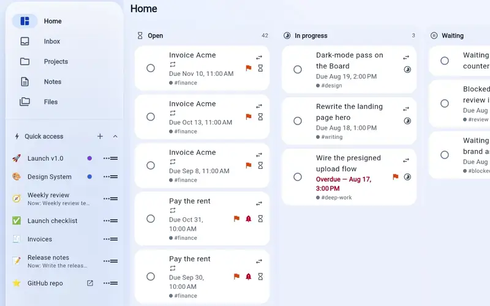
<p><b>Tasks that belong to projects.</b> A task is not a line in a list: it carries its project, tags, checklist and attachments, shows up wherever the project does, and becomes an event in the Google Calendar you pick. Edits made in Google come back.</p>
</td>
<td width="50%" valign="top">
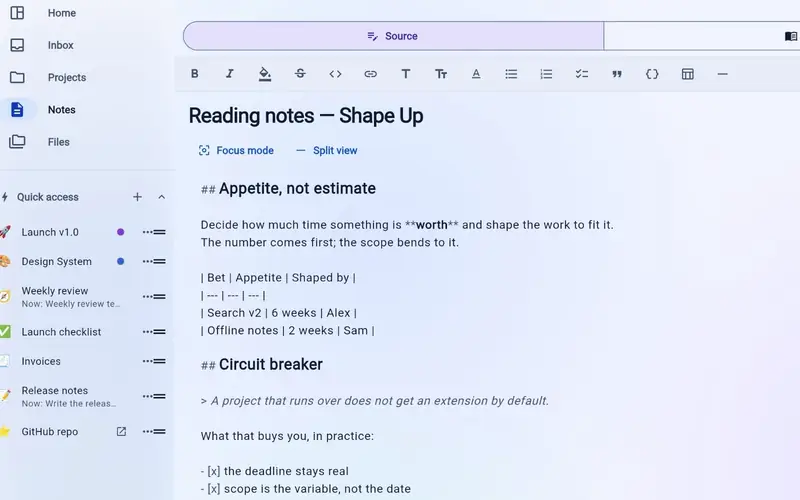
<p><b>Markdown notes, rendered properly.</b> GitHub-flavoured markdown with tables, task lists, footnotes, callouts, KaTeX and Mermaid drawn as diagrams. Reading, rich editor and source views of one document; external <code>.md</code> files are edited in place and never autosaved behind your back.</p>
</td>
</tr>
<tr>
<td width="50%" valign="top">
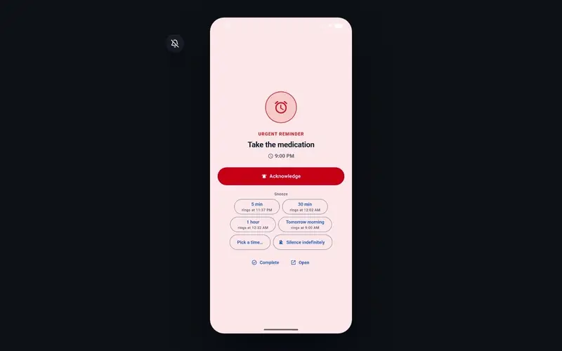
<p><b>Alarms, not chimes.</b> Urgent tasks ring through Silent mode and Focus (AlarmKit on iOS 26, Android's alarm channel), alert again across the next half hour until acknowledged, and offer snooze presets that say when they will ring again. When the system gets in the way, the app writes down why.</p>
</td>
<td width="50%" valign="top">
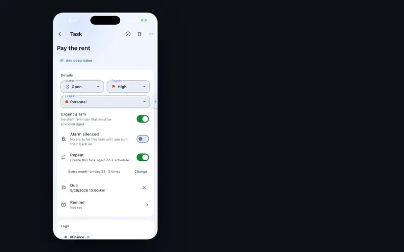
<p><b>Repeats that keep count.</b> Every day, weekday, week, month or year; the last day of the month; the 2nd Tuesday; the first Monday after the 22nd. A live preview of the next five dates before you save, and real task rows twelve months ahead.</p>
</td>
</tr>
</table>

**Files next to the work.** Attach from Photos, the camera or Files; images open in a pinch-and-zoom
viewer; everything in a project is listed in its Files tab, in folders you control, stored in your
own Cloudflare R2 or S3 bucket.

<details>
<summary><b>Why the 31st matters</b>: a monthly rule beside Google Calendar's</summary>

Ask for **the 31st** and RFC 5545, which Google Calendar follows, simply **skips** every month
without one. Your rent does not skip February.

| Rule: every month on day 31 | Google Calendar | **AllisWell** |
| --------------------------- | --------------- | ------------- |
| December                    | 31 Dec          | 31 Dec        |
| January                     | 31 Jan          | 31 Jan        |
| **February**                | **skipped**     | **28 Feb**    |
| March                       | 31 Mar          | 31 Mar        |
| **April**                   | **skipped**     | **30 Apr**    |

<p align="center">
  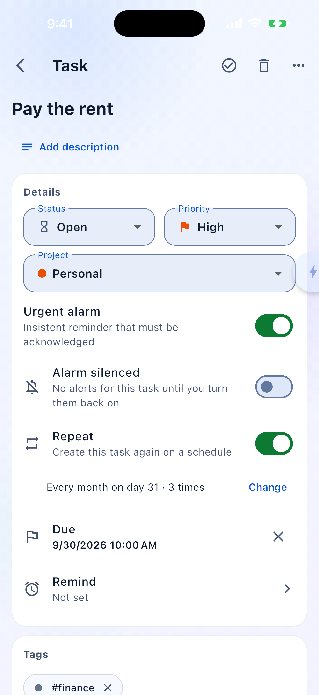
  &nbsp;
  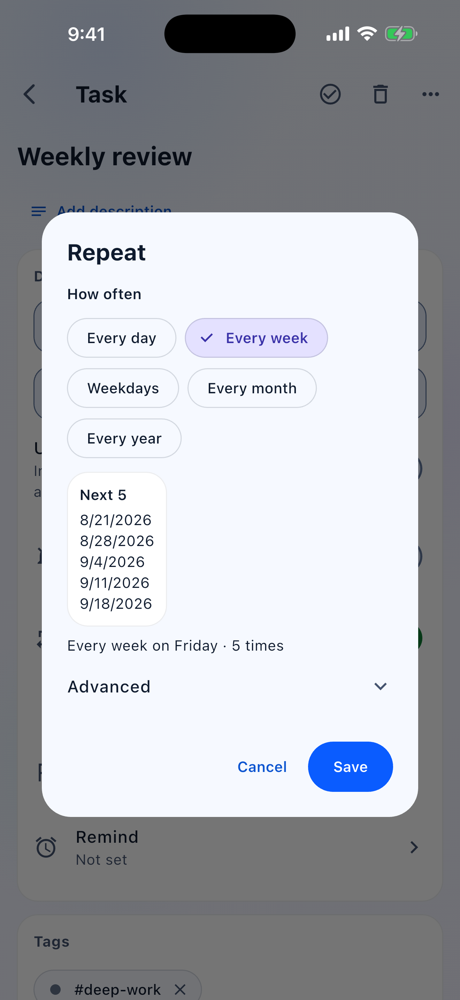
</p>

</details>

## Use it from Claude or ChatGPT

<p align="center">
  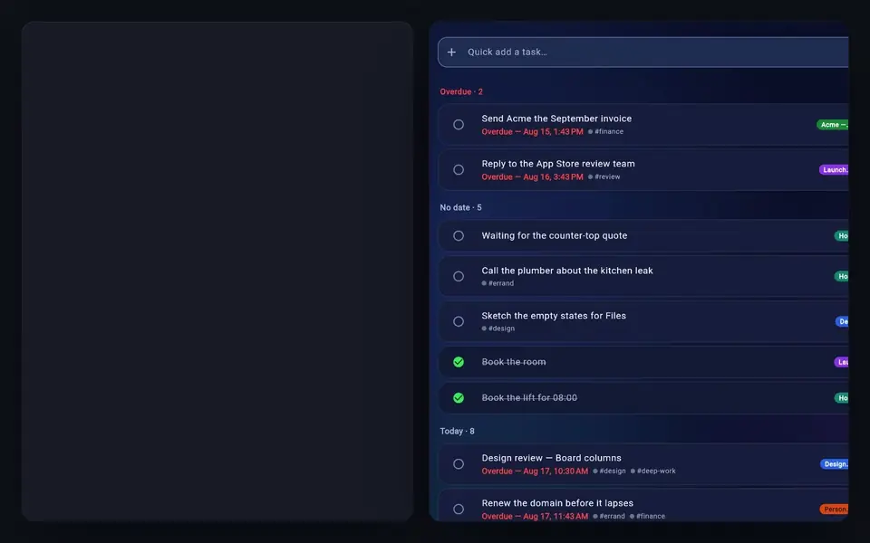
</p>

AllisWell is a **remote MCP server**. Add it to the Claude or ChatGPT account you already pay for,
sign in once, and ask about your day from inside the assistant. Twenty-five tools over tasks,
checklists, reminders, notes, projects, tags and search; every write asks for your approval, every
AI change is logged, and there is **no delete tool**.

| You use… | Connector URL |
| --- | --- |
| **alliswell.space** | **`https://api.alliswell.space/mcp`** |
| Your own server | `<API_PUBLIC_URL>/mcp`, e.g. `https://api.your-domain.example/mcp` |

<details>
<summary><b>Setup for Claude, Claude Team, ChatGPT and Claude Code</b></summary>

The URL is on the **API** host; `alliswell.space/mcp` is the website.

- **Claude** (Free / Pro / Max): Settings → Connectors → **Add custom connector** →
  paste the URL → **Connect** → sign in with your AllisWell email and password.
- **Claude Team / Enterprise:** an Owner adds it once under Organization settings →
  Connectors (any OAuth option works, no client ID or secret); each member presses
  **Connect** under Settings → Connectors.
- **ChatGPT** (Plus / Pro / Business): Settings → Apps & Connectors → Advanced
  settings → Developer mode → create a connector with the URL.
- **Claude Code:** `claude mcp add --transport http alliswell https://api.alliswell.space/mcp`

OAuth 2.1 with PKCE; dynamic client registration and client ID metadata documents are both
supported. Full guide, tool list and troubleshooting:
**[alliswell.space/docs/mcp](https://alliswell.space/docs/mcp)** ([docs/MCP.md](docs/MCP.md)).
Prefer scripts? The same surface is a REST API with personal keys: [docs/API.md](docs/API.md).

</details>

## Run it yourself

<p align="center">
  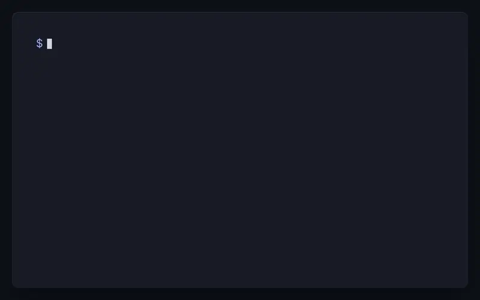
</p>

Two published images, the API and the web app, for `linux/amd64` and `linux/arm64`, tagged on
every release:

```bash
curl -O https://raw.githubusercontent.com/mahirozdin/alliswell/main/docker-compose.selfhost.yml
curl -o .env https://raw.githubusercontent.com/mahirozdin/alliswell/main/.env.selfhost.example

echo "JWT_ACCESS_SECRET=$(openssl rand -hex 32)"  >> .env
echo "JWT_REFRESH_SECRET=$(openssl rand -hex 32)" >> .env
nano .env   # your domains + database passwords

docker compose -f docker-compose.selfhost.yml up -d
```

The API creates and migrates its own schema on start, so an upgrade is `pull` + `up -d` and
**your data lives in named volumes that an upgrade never touches**. The web image reads your API
address at container start, so one prebuilt image serves any domain. TLS and reverse proxy,
upgrades and backups, R2 attachments, Google Calendar, troubleshooting:
**[docs/SELF-HOSTING.md](docs/SELF-HOSTING.md)**.

## Get it

| Where | How |
| --- | --- |
| **Web** | **[alliswell.space/app](https://alliswell.space/app)**: sign up and use it on every device. Nothing to install. |
| **iPhone and iPad** | **[App Store](https://apps.apple.com/app/alliswell-todo-and-reminders/id6794964494)**, free. |
| **Android** | **[Google Play](https://play.google.com/store/apps/details?id=com.alliswell.alliswell)**, free. |
| **Windows and Linux** | **[Windows (.zip)](https://github.com/mahirozdin/alliswell/releases/latest/download/alliswell-windows-x64.zip)** and **[Linux (.tar.gz)](https://github.com/mahirozdin/alliswell/releases/latest/download/alliswell-linux-x64.tar.gz)**, attached to every [release](https://github.com/mahirozdin/alliswell/releases/latest). |
| **macOS** | Builds from the source for now. |
| **Your own server** | One `docker compose up`, [above](#run-it-yourself). |
| **Claude and ChatGPT** | The connector at **`https://api.alliswell.space/mcp`**, [above](#use-it-from-claude-or-chatgpt). |

<details>
<summary><b>Desktop notes</b>: what the Windows and Linux builds need</summary>

Unzip (Windows 10/11, 64-bit) or extract (Linux, 64-bit) and run `alliswell.exe` or
`./alliswell`; nothing to install. The builds are unsigned, so SmartScreen asks once (More info ›
Run anyway). On Linux the app needs GTK 3, libsecret with a running keyring (GNOME Keyring or
KWallet, where your session is stored) and GStreamer for the alarm sound; on Debian/Ubuntu that
is `libgtk-3-0 libsecret-1-0 gstreamer1.0-plugins-base gstreamer1.0-plugins-good`. The app talks
to alliswell.space by default; point it at your own server from the sign-in screen.

</details>

## How it compares

|                                        | **AllisWell** | Google Calendar | Google Tasks | Apple Reminders | Things 3 |
| -------------------------------------- | :-----------: | :-------------: | :----------: | :-------------: | :------: |
| **Source available**                   |       ●       |        ○        |      ○       |        ○        |    ○     |
| **Self-hosted, your database**         |       ●       |        ○        |      ○       |        ○        |    ○     |
| Price                                  |     free      |      free       |     free     |      free       |   ~$80   |
| iOS · Android · Web · desktop          |       ●       |        ◐        |      ◐       |        ○        |    ○     |
| Works fully offline                    |       ●       |        ◐        |      ◐       |        ●        |    ●     |
| Kanban board                           |       ●       |        ○        |      ○       |        ◐        |    ○     |
| Rich notes &amp; file attachments      |       ●       |        ◐        |      ○       |        ◐        |    ○     |
| **Alarms through Silent + Focus**      |       ●       |        ○        |      ○       |        ◐        |    ○     |
| **Re-alert until acknowledged**        |       ●       |        ○        |      ○       |        ○        |    ○     |
| **Recurrence clamps (31st → 28 Feb)**  |       ●       |        ○        |      ○       |        ●        |    ●     |
| **Two-way Google Calendar sync**       |       ●       |     native      |    native    |        ○        |    ○     |
| **Accent-insensitive search**          |       ●       |        ○        |      ○       |        ○        |    ○     |
| **MCP connector for Claude / ChatGPT** |       ●       |        ○        |      ○       |        ○        |    ○     |

<sub>● full · ◐ partial · ○ none. Competitor behaviour as of mid-2026.</sub>

**Where they beat us — honestly.** Apple Reminders has **location-based** and
**messaging-based** reminders we simply don't have. Google and Apple Calendar do
invitations, RSVPs and free/busy; we mirror to your calendar and let it do that.
Todoist and Apple Reminders have **real collaboration** — assignees, comments,
shared lists — where our workspace model exists but the sharing UI does not.
Things 3 has had ten years to sand its corners; we are a young product. And
**self-hosting is work**: a managed app has no `docker compose`, no TLS
certificate and no backups to think about.

**Already self-hosting?** Then Vikunja, Super Productivity, Tasks.org and Nextcloud
Tasks are the real alternatives, and some of them beat us — sharing, tasks over CalDAV, a public
demo, more importers (we read Todoist and TickTick), years of maturity. The side-by-side, checked against their own docs,
is in [docs/COMPARISON.md §7](docs/COMPARISON.md#7-self-hosted-alternatives-checked-2026-10).

**The full analysis** — every claim above, the things they do better, and the
lines we deliberately did _not_ write — is in **[docs/COMPARISON.md](docs/COMPARISON.md)**.

<details>
<summary><b>Switch from Todoist or TickTick</b></summary>

Bring your tasks with you: **Settings › Data › Import**.

1. **Export** from the app you are leaving. Todoist: Settings › Backups (a ZIP), or a
   project's menu › Export as CSV. TickTick: on the web, Settings › Backup & Import ›
   Generate backup.
2. **Choose the file.** The wizard shows what will come in before anything is written:
   how many tasks, repeating tasks, sub-items, projects and tags, and every item it could
   not carry over exactly.
3. **Import.** Run the same file again later and nothing is duplicated: what is already
   here is skipped, and a task you deleted stays deleted.

What maps to what: projects and lists → projects, labels, sections and columns → tags,
sub-tasks → checklist items, priorities p1–p4 → high / medium / low / none, due dates with
their time and time zone, repeats → AllisWell repeats where the rule is exact (anything
else stays in the task's description with a note), comments → the description. Completed
tasks are optional (TickTick; Todoist's exports leave them out). Imported tasks never ring
as urgent alarms. The same import is one API call
([docs/API.md](docs/API.md#moving-in-from-todoist-or-ticktick)).

Apple Reminders has no export file, so there is no importer for it.

</details>

<details>
<summary><b>More screenshots</b>: board, notes, files, phones</summary>

<table>
<tr>
<td width="50%">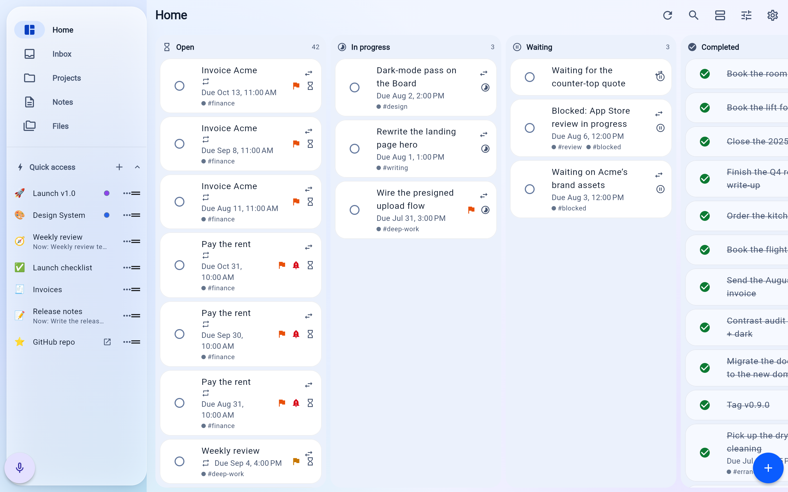</td>
<td width="50%">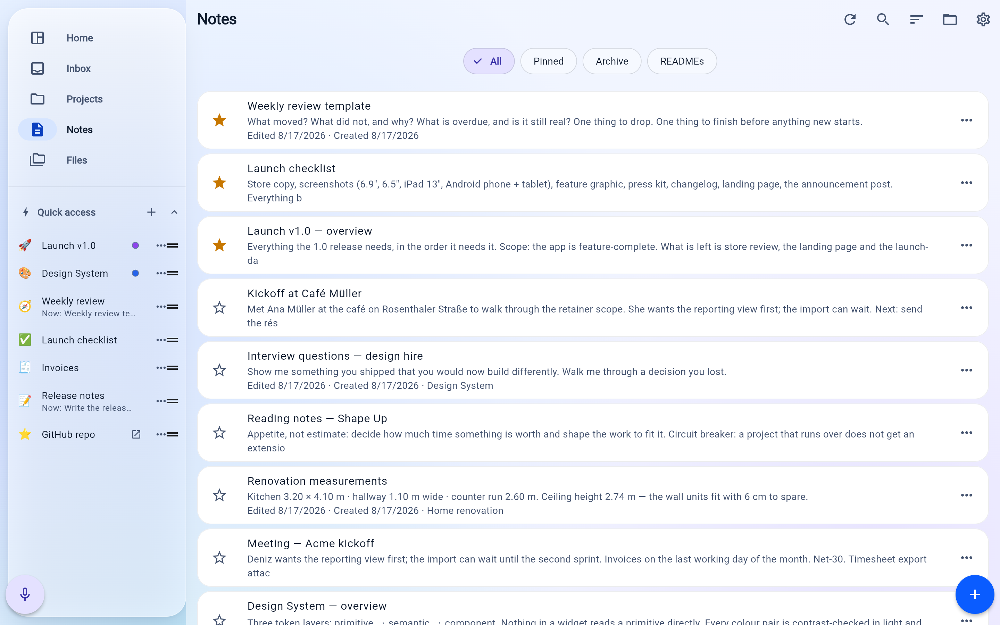</td>
</tr>
<tr>
<td><b>Board</b> — the same day as a kanban, with columns you name, hide and reorder</td>
<td><b>Notes</b> — Markdown documents, pinned, linked to a project, exportable</td>
</tr>
<tr>
<td>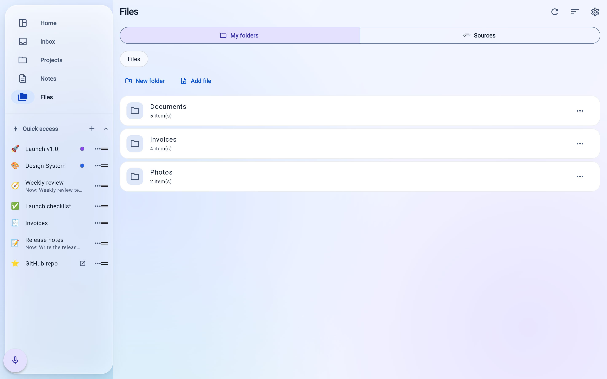</td>
<td>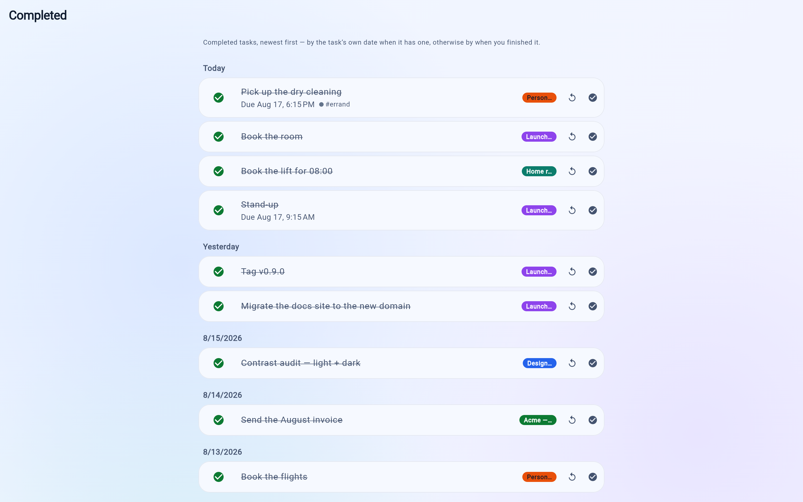</td>
</tr>
<tr>
<td><b>Files</b> — folders + every attachment, in your own R2/S3 bucket</td>
<td><b>Completed</b> — an infinite, day-headed timeline. Nothing vanishes mid-tap</td>
</tr>
</table>

<p align="center"><em>On the phone — the same local-first app, from one Flutter codebase:</em></p>

<p align="center">
  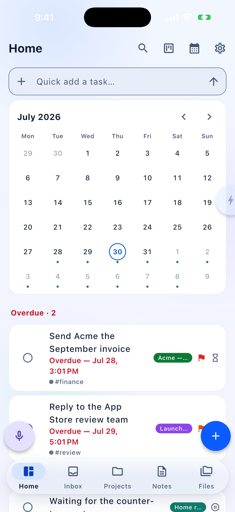
  &nbsp;
  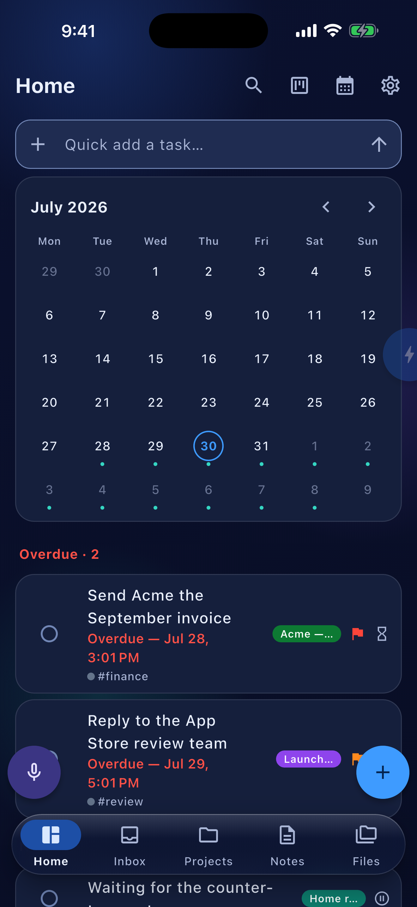
  &nbsp;
  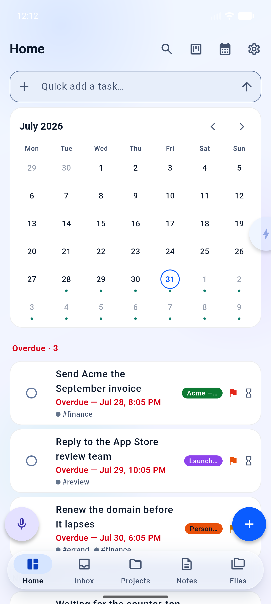
  &nbsp;
  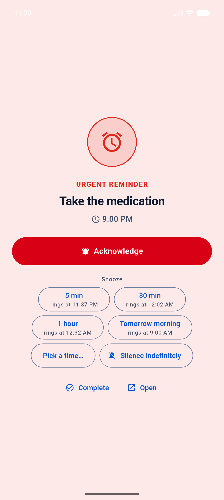
  &nbsp;
  <picture>
    <source media="(prefers-color-scheme: dark)" srcset="screenshots/ios/13-widget-dark.png">
    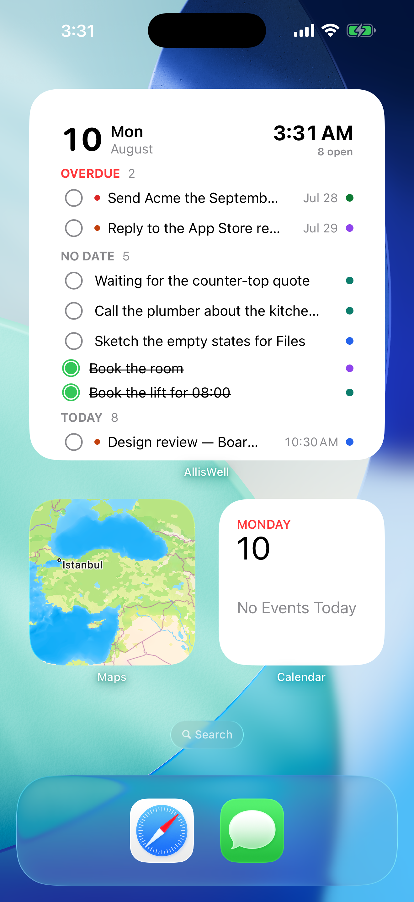
  </picture>
</p>

<p align="center"><sub>iPhone 17 Pro Max · Pixel 9 Pro XL · light, dark, an alarm actually going off, and the Home Screen widget with a clock that really ticks · every one a real capture from a running app, not a mock-up.<br>
How they are produced: <a href="docs/SCREENSHOTS.md">docs/SCREENSHOTS.md</a></sub></p>

</details>

<a name="widgets"></a>

<details>
<summary><h2>Widgets</h2></summary>

<p align="center">
  
  &nbsp;
  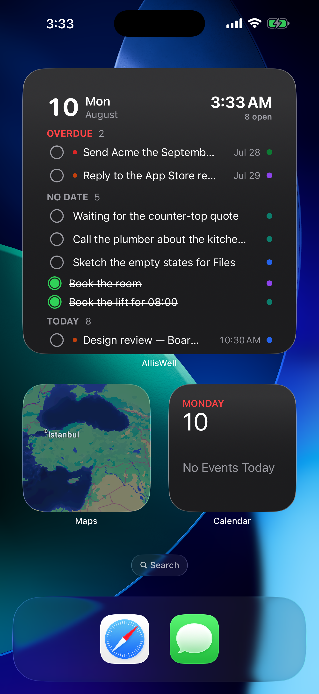
</p>

The widget is Home, at a glance — the same buckets (overdue · no date · today · this
week · this month), worked out by the app and drawn natively, so it never disagrees
with the list you open.

- **Tap the circle, the task is done** — without opening the app (iPhone and iPad on
  iOS 17+, Android; the Mac on macOS 14+ once its widget target is signed — below).
  It is an ordinary completion: it works offline and syncs like any other.
- **"+" opens the app on the new-task sheet**, the day already filled in.
- **One widget per project, if you like** — each widget can show everything or a
  single project (edit the widget on Apple platforms; long-press → reconfigure on
  Android).
- **The lock screen** (iPhone): the next task and when it is due, and how many tasks
  today still holds.
- **A clock that really ticks** in the header, in the date format you chose in the app.
- **Private widget and Compact widget** in *Settings › General › Widget*. Private
  shows "Private task" instead of every title — and the titles are never written for
  the widget at all, so they do not leave the app.
- Sizes: medium and large on iPhone, extra large on iPad and Mac, and a freely
  resizable widget on Android, which also turns the day over at midnight on its own.

**Self-hosting?** Widgets need nothing from your server: the app writes a small
snapshot for them from its local copy of your data, so every instance gets them as
they are. If you build and sign the app yourself under your own identifiers, the
iOS app and its widget extension must share one App Group (`group.com.alliswell.alliswell`
here — change it in both entitlements and in `widget_host.dart` together); Android
needs nothing; the macOS widget target is added by a script and signed once in Xcode
([`SETUP.md`](apps/app/macos/AllisWellWidgetMac/SETUP.md)). The whole design, with
the traps we measured on the way: [docs/WIDGETS.md](docs/WIDGETS.md).

</details>

<details>
<summary><h2>Every feature</h2></summary>

- **Fast capture** — a task in seconds, with or without a date; a dedicated **Inbox** keeps unplanned thoughts out of your day until you're ready. Plus **press-and-hold to talk**, **share any text or link** into the app, and **natural-language quick add, offline, in Turkish and English** — "tomorrow 9am pay rent #home p1" becomes a dated, tagged task, with the recognized words shown as chips you can undo (the optional ✨ AI parse still splits a sentence into several tasks).
- **Home, your way** — one chronological view (overdue · today · this week · next 30 days) with an Apple-style month calendar, **or** flip to a **Board (kanban)** with your own hideable, reorderable status columns and drag-to-move.
- **Projects** — colours, favourites, archiving, a Notion-style README note as the overview, and per-project Tasks / Notes / Files tabs.
- **Tags &amp; priorities** — type `#tags` inline (auto-create, colours, fold-matched suggestions) and set `none → urgent` priority. Checklists inside a task.
- **Alarm-grade reminders** — exact-minute delivery, **urgent alarms through Silent mode &amp; Focus**, a re-alert-until-acknowledged chain you can tune, snooze presets (5 m / 30 m / 1 h / tomorrow / custom) that each say when they'll ring, **mute one task's alarms** without completing it, your own ringtone, an **alarm log**, and a privacy mode that hides task content on the lock screen.
- **Recurring tasks that survive a short month** — see [the repeats section above](#five-things-it-does).
- **Instant search** — case- **and accent-insensitive** across the Latin alphabets ("muller" finds _Müller_, "cafe" finds _café_), ranked title → tag → body, running locally over the on-device replica, so it works **offline**. The folding is the app's own, so results never depend on your database's collation.
- **Notes &amp; documents** — Markdown notes with live syntax while you type, a real GFM reading view (tables, task lists, footnotes, KaTeX, Mermaid), inline images, links to tasks and projects, pin/archive, card grid or list, and `.md` / PDF export. The engine is our own [markdown_forge](https://pub.dev/packages/markdown_forge) package (MIT) — extracted so any Flutter app can use it.
- **Calendar sync** — **two-way with Google Calendar**: your tasks become events, edits in Google come back, and your Google events show up on Home. On iPhone and Mac, tasks are also mirrored into **Apple Calendar** (one-way for now). Every task is on the calendar, and it is **not a setting**.
- **Attachments &amp; Files** — attach any file to tasks, notes and projects, plus a global **Files** section with nestable folders — stored in **Cloudflare R2 / any S3** via presigned URLs (the API never proxies your bytes).
- **Local-first realtime sync** — offline by default: a mutation outbox, a revision log, idempotent push with field-level last-write-wins, and a Socket.IO channel that fans changes to every device within a round-trip.
- **Finish things visibly** — a completed task stays on today's list, struck through and calm, until the next midnight; everything older lives in **Settings ▸ Completed**, a day-headed timeline you can scroll back through.
- **Delete like you expect** — swipe a row from the right, it half-opens, and the red **Delete** is what deletes. Tasks, notes, projects and files, with an **Undo** that works by not having written anything yet.
- **Quick access** — a personal shortcut list for the projects, tasks, notes, folders, files and links you actually live in, with your own emoji, colour and order. A **sidebar section** on desktop and web, a popover on narrow windows, and a **draggable floating button** on phones. Yours alone: shortcuts never leak to other members of a shared workspace.
- **AI, on your terms (optional)** — use it from the Claude or ChatGPT you already pay for ([above](#use-it-from-claude-or-chatgpt)), or bring your own key in the app: Anthropic, OpenAI, Gemini, OpenRouter or a local Ollama. Off by default; every proposed task waits for your tap.
- **Home-screen widgets** — iPhone, iPad, Android and (one signing step away) Mac widgets that mirror your Home buckets, carry the **system clock and how many tasks today actually holds** in the header, complete a task with one tap, follow one project if you want them to, and sit on the iPhone lock screen — see [Widgets](#widgets).
- **Sign in the way you already do** — e-mail and password, **Continue with Google**, or **Continue with Apple**. The provider proves who you are; **AllisWell's own database still owns the account**, so a self-hosted instance works the same way — or drops social sign-in entirely and keeps passwords. [How it works →](docs/adr/0026-social-sign-in.md)
- **Localisation** — ships in English and Turkish, auto-detected from your system; adding a language is dropping in one JSON file.
- **Self-hosted &amp; private** — your MySQL, your server, one `docker compose up`. Free for personal use ([licence](#-licence--commercial-use)).

</details>

<details>
<summary><h2>Architecture</h2></summary>

```txt
Flutter App (iOS / Android / macOS / Windows / Linux / Web)
      │  REST + WebSocket (Socket.IO)   ·   offline-first local SQLite replica
      ▼
Node.js API — Fastify, JavaScript only (no TypeScript)
  ├─ Auth (JWT + refresh rotation)     ├─ Sync engine (revision log, outbox)
  ├─ Projects / Tasks / Tags           ├─ Reminder scheduler
  ├─ Notes / Files (presigned R2/S3)   ├─ Calendar sync workers (BullMQ)
  ├─ Recurrence engine (task_series)   ├─ Remote MCP server (OAuth 2.1)
  └─ Search (accent folding)           └─ AI providers (BYOK, 5 adapters)
      │
      ├─ MySQL 8.4 / MariaDB 10.11+  (canonical data)
      ├─ Redis 8    (queues, Socket.IO fan-out, cache)
      ├─ Object storage: Cloudflare R2 / any S3 (attachments)
      └─ Calendar providers: Google Calendar API · Apple EventKit · CalDAV (iCloud, Nextcloud…)
```

The monorepo:

| Path                                             | What it is                                                      |
| ------------------------------------------------ | --------------------------------------------------------------- |
| [`apps/api`](apps/api)                           | Fastify backend — JavaScript only, MySQL via knex               |
| [`apps/app`](apps/app)                           | The Flutter app — all six platforms, one codebase               |
| [`apps/landing`](apps/landing)                   | This site — Vue 3 + Vite, served at the root of alliswell.space |
| [`scripts/seed-demo.mjs`](scripts/seed-demo.mjs) | The demo workspace every screenshot is shot from                |
| [`scripts/screenshots/`](scripts/screenshots)    | Screenshot + store-asset pipeline                               |

Details: [docs/ARCHITECTURE.md](docs/ARCHITECTURE.md) • Design decisions: [docs/adr/](docs/adr/)

</details>

<details>
<summary><h2>Quickstart (development)</h2></summary>

Prerequisites: **Node.js ≥ 22**, **Docker**, **Flutter ≥ 3.44** (for the app).

```bash
git clone https://github.com/mahirozdin/alliswell.git
cd alliswell

# 1. Infra: MySQL + Redis (+ MinIO for attachments)
cp .env.example .env
docker compose up -d mysql redis

# 2. API
npm install
npm run db:migrate
npm run dev              # → http://localhost:3000  (health: /health/ready)

# 3. Flutter app
cd apps/app
flutter pub get
flutter run -d chrome    # or: macos / windows / an emulator
```

Want the app full of realistic data in one command?

```bash
npm run seed:demo        # demo@alliswell.space / AllisWellDemo2026
```

Run everything in containers instead: `docker compose --profile full up`.
Optional DB admin UI: `docker compose --profile tools up -d adminer` → http://localhost:8080.

**Optional integrations** (all off until configured, see [.env.example](.env.example)):
Google Calendar (`GOOGLE_*`), file attachments via Cloudflare R2 / any S3 (`STORAGE_S3_*`),
and AI (`AI_*` — off by default; see [docs/AI.md](docs/AI.md)).

### Useful commands

| Command                              | What it does                                    |
| ------------------------------------ | ----------------------------------------------- |
| `npm run dev`                        | Start API with watch mode                       |
| `npm test`                           | API unit tests (no infra needed)                |
| `npm run test:integration`           | API integration tests (needs MySQL+Redis)       |
| `npm run seed:demo`                  | Fill a running instance with the demo workspace |
| `npm run shots:web`                  | Regenerate the web screenshots                  |
| `npm run landing:dev`                | Run the marketing site locally                  |
| `npm run lint` / `npm run format`    | ESLint / Prettier                               |
| `npm run db:migrate` / `db:rollback` | Knex migrations                                 |
| `npm run check:no-ts`                | Enforce the JavaScript-only policy              |
| `npm run check:i18n`                 | Enforce no hardcoded UI strings (localisation)  |
| `npm run next`                       | Print the next task from docs/TASKS.md          |
| `npm run verify:task -- <tests>`     | The narrow check for the change in hand (K1)    |
| `npm run verify:batch`               | Everything CI checks, once, before a push (K2)  |


</details>

<details>
<summary><h2>Documentation</h2></summary>

| Doc                                                                                      | Purpose                                                                                   |
| ---------------------------------------------------------------------------------------- | ----------------------------------------------------------------------------------------- |
| [docs/COMPARISON.md](docs/COMPARISON.md)                                                 | Full feature inventory + honest comparison with Google, Apple, Things 3 and the self-hosted alternatives (Vikunja, Super Productivity, Tasks.org, Nextcloud Tasks) |
| [docs/BLUEPRINT.md](docs/BLUEPRINT.md)                                                   | Product vision, domain model, full functional spec (TR)                                   |
| [docs/ARCHITECTURE.md](docs/ARCHITECTURE.md)                                             | System architecture, stack, sync &amp; calendar design                                    |
| [docs/SELF-HOSTING.md](docs/SELF-HOSTING.md)                                             | Run your own instance with Docker: TLS, upgrades, backups, storage                        |
| [docs/AI.md](docs/AI.md) · [docs/MCP.md](docs/MCP.md)                                    | AI providers &amp; consent · the remote MCP connector                                     |
| [docs/API.md](docs/API.md) · [live](https://alliswell.space/docs/api)                     | The REST API &amp; personal API keys: every endpoint with examples, plus a Postman collection |
| [docs/FIREBASE.md](docs/FIREBASE.md)                                                     | Analytics, Crashlytics, Performance — optional, and how to point them at **your** project |
| [docs/ATTACHMENTS.md](docs/ATTACHMENTS.md)                                               | File attachments: R2/S3 storage, presigned flow, CORS setup                               |
| [docs/MARKDOWN.md](docs/MARKDOWN.md)                                                     | The markdown workspace: field survey, feature scope, document model                       |
| [docs/NOTIFICATIONS.md](docs/NOTIFICATIONS.md)                                           | Exact-time / urgent alarm delivery research &amp; plan                                    |
| [docs/WIDGETS.md](docs/WIDGETS.md)                                                       | Home-screen widget architecture                                                           |
| [docs/SCREENSHOTS.md](docs/SCREENSHOTS.md)                                               | How every image in this repo is produced                                                  |
| [docs/STORE-LISTING.md](docs/STORE-LISTING.md)                                           | App Store &amp; Play copy, asset sizes, claim guardrails                                  |
| [ROADMAP.md](ROADMAP.md)                                                                 | Phase-by-phase roadmap: shipped, next, and v2 parking lot                                 |
| [docs/TASKS.md](docs/TASKS.md) · [docs/STATE.md](docs/STATE.md)                          | Open OPH-xxx tasks · live development state                                               |
| [CHANGELOG.md](CHANGELOG.md)                                                             | What changed, per release                                                                 |
| [docs/adr/](docs/adr/)                                                                   | Architecture Decision Records                                                             |
| [AGENTS.md](AGENTS.md) · [CONTRIBUTING.md](CONTRIBUTING.md) · [SECURITY.md](SECURITY.md) | Workflow, contributing &amp; security policy                                              |


</details>

<details>
<summary><h2>Built to be developed by AI agents</h2></summary>

This repository is designed for continuous development by AI coding agents:

1. `npm run next` prints the **next task** ([docs/STATE.md](docs/STATE.md) names it too).
2. Say **"do the next task"** (Turkish: _"sıradaki işi yap"_).
3. The agent follows [AGENTS.md](AGENTS.md): implement → its own tests (`verify:task`) → update docs → remove the finished task from [docs/TASKS.md](docs/TASKS.md) → update STATE → commit; the full set (`verify:batch`) runs once before a push.
4. For a run of many tasks, a phase workflow takes a whole epic ([docs/development/workflow.md](docs/development/workflow.md)): a fresh agent per task, then the full set, a smoke run and a review once at the end.

The markdown files (STATE / TASKS / CHANGELOG) are the single source of truth — no external board required.

</details>

## Enterprise edition

Everything above is the free edition, and it is built for one person's work. **AllisWell
Enterprise** is a separate, commercially licensed edition for organisations where work is
filed between departments rather than kept on one list:

- **Teams on their own subdomains** — one instance, several organisations, isolated on the
  server rather than in the interface.
- **Permissions and units** — named permissions that roles are assembled from, and a unit
  per department, workshop or site, with explicit sharing between them.
- **A service desk** — a service catalogue routed to units, tickets that stay distinct from
  tasks, SLA targets that run on a shift-aware business calendar, and health checks that
  open an incident when a service goes down.
- **A public request portal** — a request form at a public URL, with expiry, revocation and
  quotas, for the people who should not have accounts.
- **Meeting recordings that become work** — a speaker-separated note with the decisions
  pulled out, and a decision that turns into a ticket.

It runs in the cloud under your organisation's own address, or on your own servers exactly
like the rest of AllisWell: your hardware, your database, no request leaving the building
unless you decide it should.

**→ [What the Enterprise edition includes](https://alliswell.space/enterprise)**
&nbsp;·&nbsp; **[Türkçe](https://alliswell.space/enterprise/tr)**
&nbsp;·&nbsp; [info@bubiapps.com](mailto:info@bubiapps.com)

It does not change the free edition in either direction — this repository stays under
PolyForm Noncommercial, and Enterprise is used under a separate written agreement. The
section below is the rule for both.

<!-- GitHub keeps the emoji's invisible U+FE0F in the heading's slug, and the docs still link this old slug; this name is what every #-licence--commercial-use link lands on. -->
<a name="-licence--commercial-use"></a>

## Licence and commercial use

**AllisWell is free for you, and not free for your employer.** That is the whole
rule; everything below is detail.

The source is public and it always will be. You can read it, fork it, change it,
and run your own instance on your own machine forever without paying anyone or
asking anyone. What you cannot do is take it into a business — resell it, offer
it as a service, or run it as part of a commercial operation.

| You are…                                                                      |             Free?             |
| ----------------------------------------------------------------------------- | :---------------------------: |
| A person, using it for your own life                                          |            ✅ Free            |
| Self-hosting your own instance at home or on your own VPS                     |            ✅ Free            |
| Studying it, forking it, submitting a fix, building on it as a hobby          |            ✅ Free            |
| A charity, school, university, public research body or government institution |            ✅ Free            |
| A company running it for your team, at any size                               | ❌ Needs a commercial licence |
| Reselling it, or offering it to others as a hosted service                    | ❌ Needs a commercial licence |

**Enterprise, or anything commercial → [info@bubiapps.com](mailto:info@bubiapps.com).**
What the Enterprise edition actually adds is one section up, and in
[alliswell.space/enterprise](https://alliswell.space/enterprise); the licence terms are
also in [docs/ENTERPRISE.md](docs/ENTERPRISE.md).
Commercial licences exist, they are not expensive, and they come with the
self-hosting support the free tier does not.

**Why this and not AGPL.** AllisWell used to be AGPL-3.0, and AGPL would have let
a competitor host the whole product commercially and comply merely by publishing
their changes. This is a single-maintainer product whose revenue is the hosted
service at [alliswell.space](https://alliswell.space) and the app stores — so the
licence now protects exactly that, and nothing else. The full reasoning, the
alternatives that were weighed (FSL, Elastic License, AGPL + commercial
exception), and the consequences are in
**[ADR-0024](docs/adr/0024-license-polyform-noncommercial.md)**.

**Being straight about the label.** PolyForm Noncommercial is **source-available**,
not OSI "open source" — it discriminates against commercial use, which the Open
Source Definition forbids. The repo used to say "open source" everywhere; it now
says source-available, because the other word would be untrue.

**If you already have v0.9.0 or earlier**, you have it under AGPL-3.0 and you
keep those rights for that copy. A licence granted cannot be taken back. These
terms apply from **v1.0.0**.

## Contributing

Contributions are very welcome — read [CONTRIBUTING.md](CONTRIBUTING.md) and pick
a task from [docs/TASKS.md](docs/TASKS.md). Please open an issue before large changes.

**Translations** are especially welcome and need no Dart: copy
`apps/app/assets/i18n/en.json` to `<code>.json`, translate the values, and
register the locale — see [CONTRIBUTING.md](CONTRIBUTING.md#translating-adding-a-language).

**Licence:** [PolyForm Noncommercial 1.0.0](LICENSE) — see
[Licence & commercial use](#-licence--commercial-use) above. Contributions are
accepted under the same terms.

## Star history

<a href="https://www.star-history.com/#mahirozdin/alliswell&Date">
  <picture>
    <source media="(prefers-color-scheme: dark)" srcset="https://api.star-history.com/svg?repos=mahirozdin/alliswell&type=Date&theme=dark">
    
  </picture>
</a>

---

<div align="center">

**[alliswell.space](https://alliswell.space)** &nbsp;·&nbsp;
**[Open the app](https://alliswell.space/app)** &nbsp;·&nbsp;
**[Google Play](https://play.google.com/store/apps/details?id=com.alliswell.alliswell)** &nbsp;·&nbsp;
**[App Store](https://apps.apple.com/app/alliswell-todo-and-reminders/id6794964494)** &nbsp;·&nbsp;
**[Star this repo](https://github.com/mahirozdin/alliswell)**

<sub>

**AllisWell**: source-available, self-hosted to-do, reminder and notes app · alternative to Todoist, Things 3, TickTick, Apple Reminders and Notion · two-way Google Calendar sync and an Apple Calendar mirror · offline-first · Flutter (iOS, Android, Web, macOS, Windows, Linux) · Node.js + MySQL.

</sub>
</div>
