<!-- AllisWell: source-available tasks, notes and alarms you can host yourself. Web, iPhone, Android, Windows and Linux; an MCP connector for Claude and ChatGPT. Animations: docs/assets/readme (HyperFrames, media/hyperframes). -->

<h1 align="center">AllisWell</h1>

<p align="center">
  <b>The to-do app whose urgent reminders ring through Silent mode, on your own server and inside Claude or ChatGPT.</b><br>
  Tasks, projects and Markdown notes on the web, iPhone, Android, Windows and Linux.
</p>

<p align="center">
  <a href="https://alliswell.space/app"><b>Try it on the web</b></a> &nbsp;·&nbsp;
  <a href="#run-it-yourself"><b>Run it on your server</b></a> &nbsp;·&nbsp;
  <a href="#download"><b>Download</b></a>
</p>

<p align="center">
  <a href="#-licence--commercial-use"></a>
  <a href="docker-compose.selfhost.yml"></a>
  <a href="docs/MCP.md"></a>
</p>

<p align="center">
  <a href="https://alliswell.space">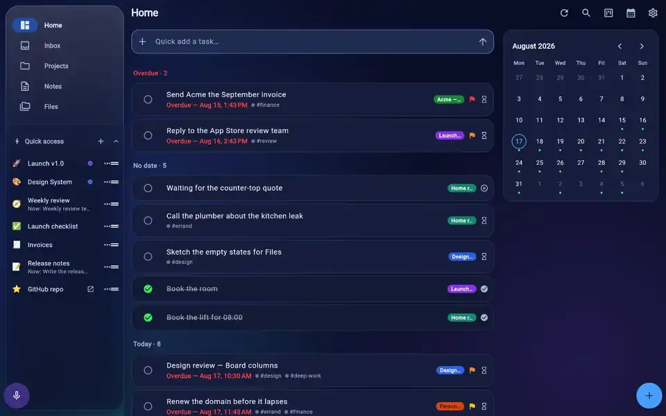</a>
</p>

## Why people pick it

- **Alarms, not chimes.** Urgent tasks ring with a real alarm sound **through Silent mode and
  Focus** and alert again over the next half hour until you acknowledge them.
- **Your server, your database.** Two files, two secrets and your domains, then
  `docker compose up` on your own machine, or the hosted copy at
  [alliswell.space](https://alliswell.space). Free for personal use either way.
- **Ask Claude or ChatGPT.** A built-in remote MCP server: every write asks for your approval,
  and there is no delete tool.
- **Two-way Google Calendar.** Tasks become events, and edits made in Google come back. On
  iPhone and Mac, tasks are also mirrored into Apple Calendar, one way.
- **Notes and files next to the work.** Markdown notes with tables, maths and Mermaid diagrams;
  files on the task or project they belong to; offline-first on every device.
- **Repeats that keep count.** Ask for the 31st and February gets the 28th.

## Get started: pick one

|   | Path | You need |
| - | --- | --- |
| 1 | **Try it on the web:** [alliswell.space/app](https://alliswell.space/app). Sign up, and it syncs to every device. | a browser |
| 2 | **Run it on your server:** two published images and one compose file, [below](#run-it-yourself). | Docker and a domain |
| 3 | **Download:** App Store, Google Play, Windows and Linux, [below](#download). | a phone or a PC |

<details>
<summary><b>Alarms and repeats in motion</b>, and why the 31st matters</summary>

<table>
<tr>
<td width="50%" valign="top">
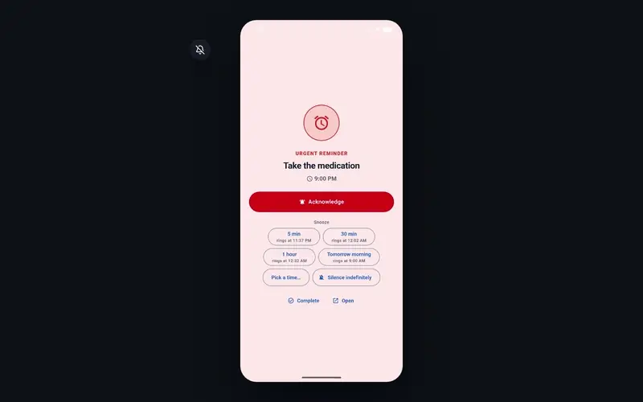
<p><b>Alarms, not chimes.</b> Urgent tasks ring through Silent mode and Focus (AlarmKit on iOS 26, Android's alarm channel), alert again across the next half hour until acknowledged, and offer snooze presets that say when they will ring again. When the system gets in the way, the app writes down why.</p>
</td>
<td width="50%" valign="top">
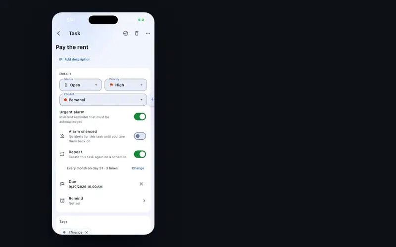
<p><b>Repeats that keep count.</b> Every day, weekday, week, month or year; the last day of the month; the 2nd Tuesday; the first Monday after the 22nd. A live preview of the next five dates before you save, and real task rows twelve months ahead.</p>
</td>
</tr>
</table>

Ask for **the 31st** and RFC 5545, which Google Calendar follows, simply **skips** every month
without one. Your rent does not skip February.

| Rule: every month on day 31 | Google Calendar | **AllisWell** |
| --------------------------- | --------------- | ------------- |
| December                    | 31 Dec          | 31 Dec        |
| January                     | 31 Jan          | 31 Jan        |
| **February**                | **skipped**     | **28 Feb**    |
| March                       | 31 Mar          | 31 Mar        |
| **April**                   | **skipped**     | **30 Apr**    |

The one-minute film plays on [alliswell.space](https://alliswell.space/#film) (English) and
[alliswell.space/tr](https://alliswell.space/tr#film) (Türkçe), with captions and a transcript.

<p align="center">
  <a href="https://alliswell.space/#film"></a>
</p>

</details>

## Use it from Claude or ChatGPT

<p align="center">
  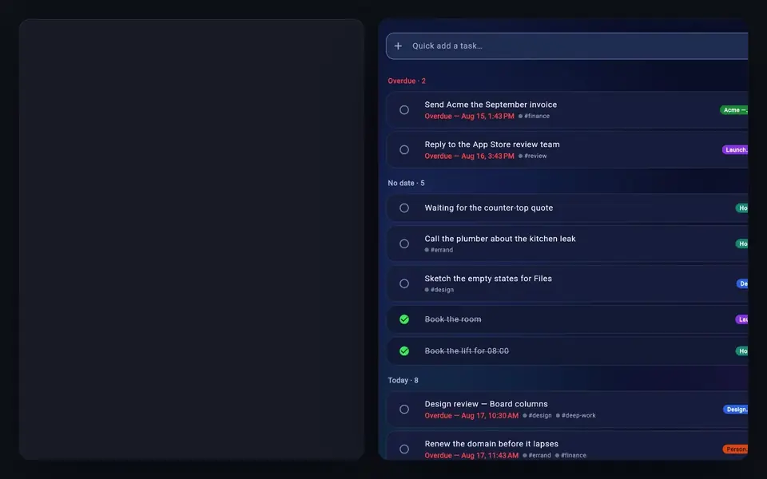
</p>

AllisWell is a **remote MCP server**. Add it to the Claude or ChatGPT account you already pay for,
sign in once, and ask about your day from inside the assistant. Twenty-five tools over tasks,
checklists, reminders, notes, projects, tags and search; every write asks for your approval, every
AI change is logged, and there is **no delete tool**.

| You use… | Connector URL |
| --- | --- |
| **alliswell.space** | **`https://api.alliswell.space/mcp`** |
| Your own server | `<API_PUBLIC_URL>/mcp`, e.g. `https://api.your-domain.example/mcp` |

<details>
<summary><b>Setup for Claude, Claude Team, ChatGPT and Claude Code</b></summary>

The URL is on the **API** host; `alliswell.space/mcp` is the website.

- **Claude** (Free / Pro / Max): Settings → Connectors → **Add custom connector** →
  paste the URL → **Connect** → sign in with your AllisWell email and password.
- **Claude Team / Enterprise:** an Owner adds it once under Organization settings →
  Connectors (any OAuth option works, no client ID or secret); each member presses
  **Connect** under Settings → Connectors.
- **ChatGPT** (Plus / Pro / Business): Settings → Apps & Connectors → Advanced
  settings → Developer mode → create a connector with the URL.
- **Claude Code:** `claude mcp add --transport http alliswell https://api.alliswell.space/mcp`

OAuth 2.1 with PKCE; dynamic client registration and client ID metadata documents are both
supported. Full guide, tool list and troubleshooting:
**[alliswell.space/docs/mcp](https://alliswell.space/docs/mcp)** ([docs/MCP.md](docs/MCP.md)).
Prefer scripts? The same surface is a REST API with personal keys: [docs/API.md](docs/API.md).

</details>

## Run it yourself

<p align="center">
  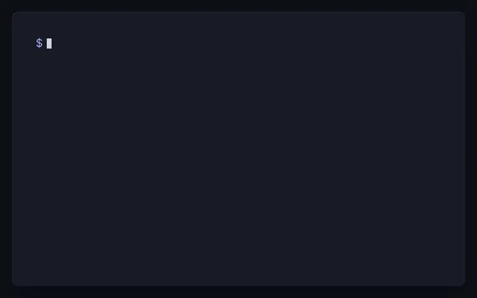
</p>

Two published images, the API and the web app, for `linux/amd64` and `linux/arm64`, tagged on
every release:

```bash
curl -O https://raw.githubusercontent.com/mahirozdin/alliswell/main/docker-compose.selfhost.yml
curl -o .env https://raw.githubusercontent.com/mahirozdin/alliswell/main/.env.selfhost.example

echo "JWT_ACCESS_SECRET=$(openssl rand -hex 32)"  >> .env
echo "JWT_REFRESH_SECRET=$(openssl rand -hex 32)" >> .env
nano .env   # your domains + database passwords

docker compose -f docker-compose.selfhost.yml up -d
```

The API creates and migrates its own schema on start, so an upgrade is `pull` + `up -d` and
**your data lives in named volumes that an upgrade never touches**. The web image reads your API
address at container start, so one prebuilt image serves any domain. TLS and reverse proxy,
upgrades and backups, R2 attachments, Google Calendar, troubleshooting:
**[docs/SELF-HOSTING.md](docs/SELF-HOSTING.md)**.

## Download

| Where | How |
| --- | --- |
| **Web** | **[alliswell.space/app](https://alliswell.space/app)**: sign up and use it on every device. Nothing to install. |
| **iPhone and iPad** | **[App Store](https://apps.apple.com/app/alliswell-todo-and-reminders/id6794964494)**, free. |
| **Android** | **[Google Play](https://play.google.com/store/apps/details?id=com.alliswell.alliswell)**, free. |
| **Windows and Linux** | **[Windows (.zip)](https://github.com/mahirozdin/alliswell/releases/latest/download/alliswell-windows-x64.zip)** and **[Linux (.tar.gz)](https://github.com/mahirozdin/alliswell/releases/latest/download/alliswell-linux-x64.tar.gz)**, attached to every [release](https://github.com/mahirozdin/alliswell/releases/latest). |
| **macOS** | Builds from the source for now. |
| **Your own server** | Four steps ending in `docker compose up`, [above](#run-it-yourself). |
| **Claude and ChatGPT** | The connector at **`https://api.alliswell.space/mcp`**, [above](#use-it-from-claude-or-chatgpt). |

<details>
<summary><b>Desktop notes</b>: what the Windows and Linux builds need</summary>

Unzip (Windows 10/11, 64-bit) or extract (Linux, 64-bit) and run `alliswell.exe` or
`./alliswell`; nothing to install. The builds are unsigned, so SmartScreen asks once (More info ›
Run anyway). On Linux the app needs GTK 3, libsecret with a running keyring (GNOME Keyring or
KWallet, where your session is stored) and GStreamer for the alarm sound; on Debian/Ubuntu that
is `libgtk-3-0 libsecret-1-0 gstreamer1.0-plugins-base gstreamer1.0-plugins-good`. The app talks
to alliswell.space by default; point it at your own server from the sign-in screen.

</details>

## How it compares

|                                                        |  **AllisWell**  |  Todoist  |  TickTick  |  Vikunja  |
| ------------------------------------------------------ | :-------------: | :-------: | :--------: | :-------: |
| **Source available**                                   |  ● PolyForm NC  |     ○     |     ○      |  ● AGPL   |
| **Self-hosted, your database**                         |        ●        |     ○     |     ○      |     ●     |
| Price                                                  | free for personal use | free tier + subscription | free tier + subscription | free |
| Native iPhone and Android apps                         |        ●        |     ●     |     ●      | ◐ "very basic features" |
| **Alarm through Silent, re-alert until acknowledged**  |        ●        |     —     |     —      | ◐ e-mail  |
| **Two-way Google Calendar**                            |        ●        |     —     |     —      |     ○     |
| **MCP for Claude / ChatGPT**                           | ● remote, OAuth, no delete tool | — | — | ● since 2.7.0, token |
| Sharing and collaboration                              | ○ personal edition |  ●     |     —      |     ●     |
| Public demo without an account                         |        ○        |     —     |     —      | ● try.vikunja.io |
| Imports Todoist and TickTick exports                   |        ●        |     —     |     —      |     ●     |

<sub>● yes · ◐ partly · ○ no · — not checked against their own documentation. Vikunja checked
2026-10-16; Todoist and TickTick are hosted products and cannot be self-hosted.</sub>

**Where they beat us, honestly.** Todoist has years of cross-platform polish and real
collaboration: assignees, comments, shared projects. TickTick puts habits, a Pomodoro timer and
a calendar in one app. Vikunja shares projects with users, teams and links, serves tasks over
CalDAV, has a public demo and imports from seven apps. And **self-hosting is work**: a managed
app has no `docker compose`, no TLS certificate and no backups to think about.

The full analysis, with Google Calendar, Apple Reminders, Things 3, Super Productivity,
Tasks.org and Nextcloud Tasks as well, and the lines we deliberately did _not_ write:
**[docs/COMPARISON.md](docs/COMPARISON.md)**.

<details>
<summary><b>Switch from Todoist or TickTick</b></summary>

Bring your tasks with you: **Settings › Data › Import**.

1. **Export** from the app you are leaving. Todoist: Settings › Backups (a ZIP), or a
   project's menu › Export as CSV. TickTick: on the web, Settings › Backup & Import ›
   Generate backup.
2. **Choose the file.** The wizard shows what will come in before anything is written:
   how many tasks, repeating tasks, sub-items, projects and tags, and every item it could
   not carry over exactly.
3. **Import.** Run the same file again later and nothing is duplicated: what is already
   here is skipped, and a task you deleted stays deleted.

What maps to what: projects and lists → projects, labels, sections and columns → tags,
sub-tasks → checklist items, priorities p1–p4 → high / medium / low / none, due dates with
their time and time zone, repeats → AllisWell repeats where the rule is exact (anything
else stays in the task's description with a note), comments → the description. Completed
tasks are optional (TickTick; Todoist's exports leave them out). Imported tasks never ring
as urgent alarms. The same import is one API call
([docs/API.md](docs/API.md#moving-in-from-todoist-or-ticktick)).

Apple Reminders has no export file, so there is no importer for it.

</details>

<details>
<summary><b>More screenshots</b>: board, notes, files, phones</summary>

<table>
<tr>
<td width="50%">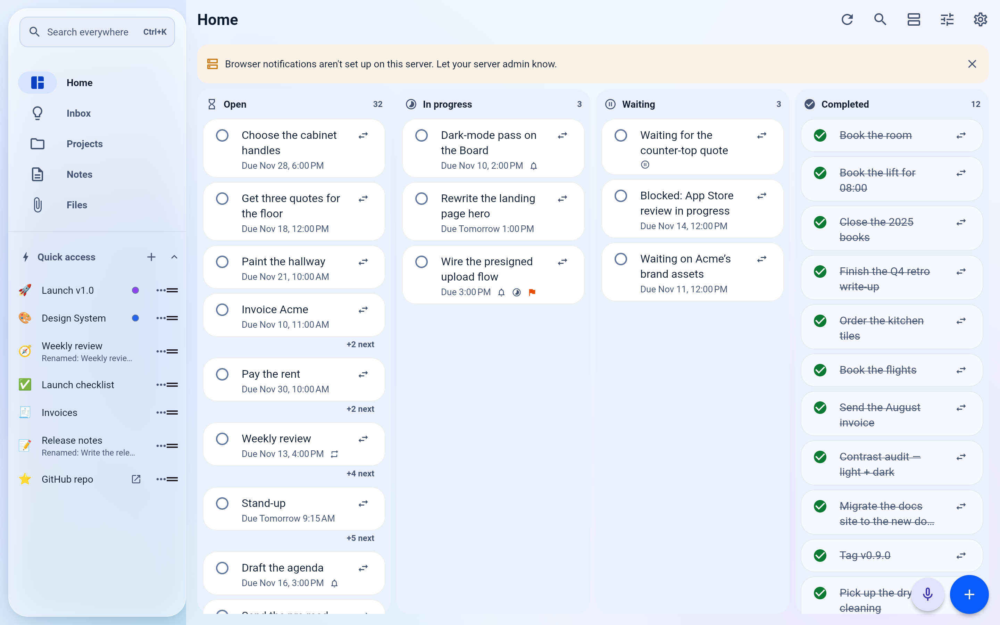</td>
<td width="50%">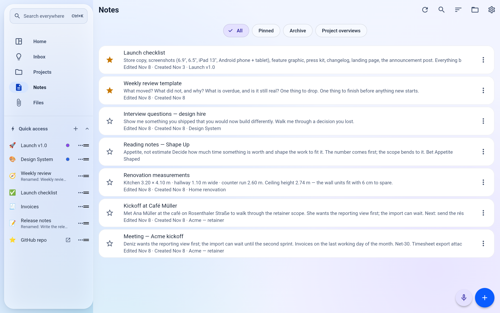</td>
</tr>
<tr>
<td><b>Board</b> — the same day as a kanban, with columns you name, hide and reorder</td>
<td><b>Notes</b> — Markdown documents, pinned, linked to a project, exportable</td>
</tr>
<tr>
<td>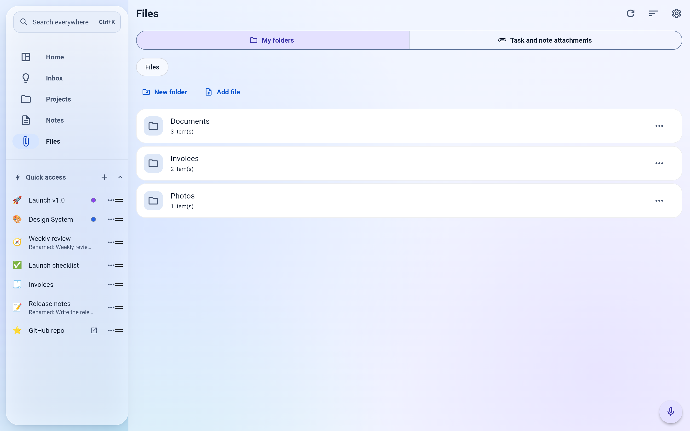</td>
<td>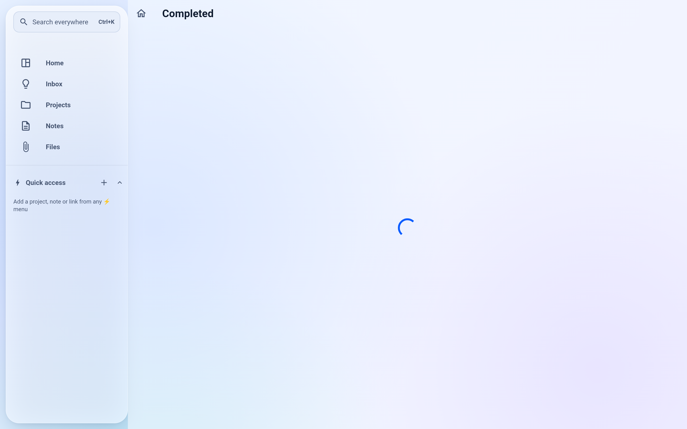</td>
</tr>
<tr>
<td><b>Files</b> — folders + every attachment, in your own R2/S3 bucket</td>
<td><b>Completed</b> — an infinite, day-headed timeline. Nothing vanishes mid-tap</td>
</tr>
</table>

<p align="center"><em>On the phone — the same local-first app, from one Flutter codebase:</em></p>

<p align="center">
  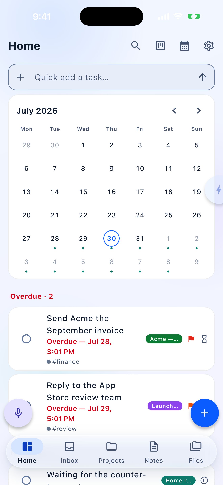
  &nbsp;
  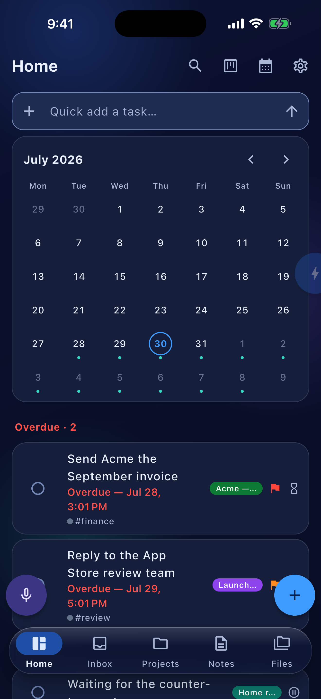
  &nbsp;
  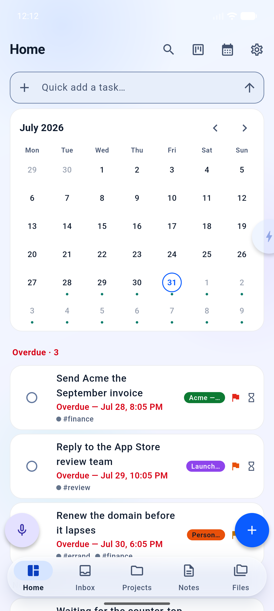
  &nbsp;
  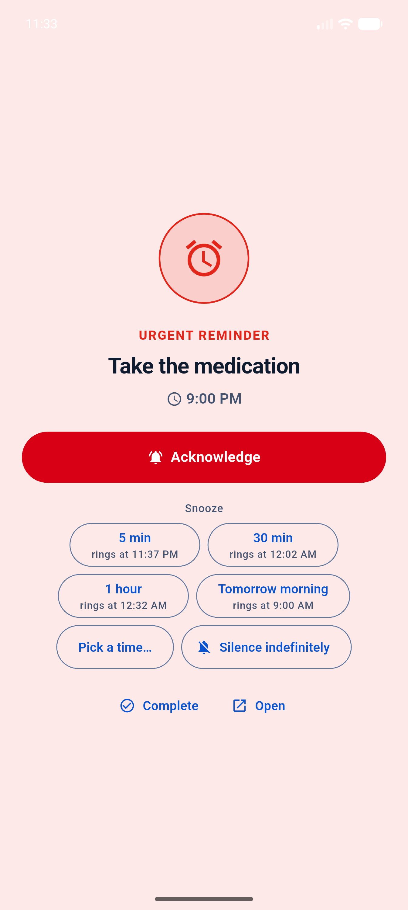
  &nbsp;
  <picture>
    <source media="(prefers-color-scheme: dark)" srcset="screenshots/ios/13-widget-dark.png">
    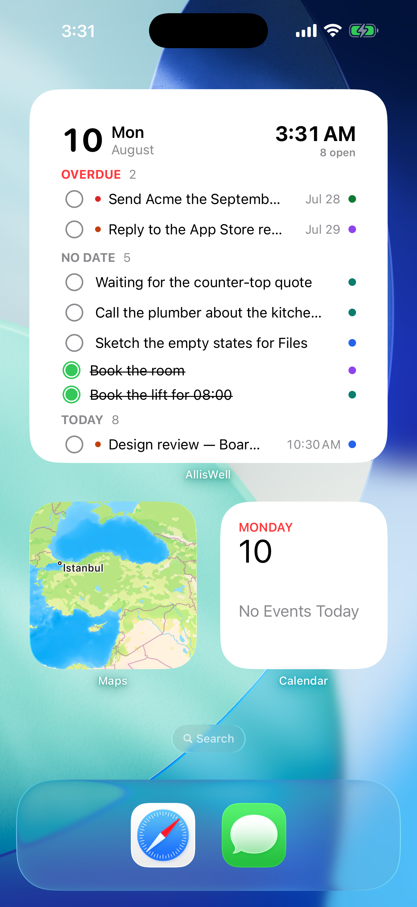
  </picture>
</p>

<p align="center"><sub>iPhone 17 Pro Max · Pixel 9 Pro XL · light, dark, an alarm actually going off, and the Home Screen widget with a clock that really ticks · every one a real capture from a running app, not a mock-up.<br>
How they are produced: <a href="docs/SCREENSHOTS.md">docs/SCREENSHOTS.md</a></sub></p>

</details>

<a name="widgets"></a>

<details>
<summary><h2>Widgets</h2></summary>

<p align="center">
  
  &nbsp;
  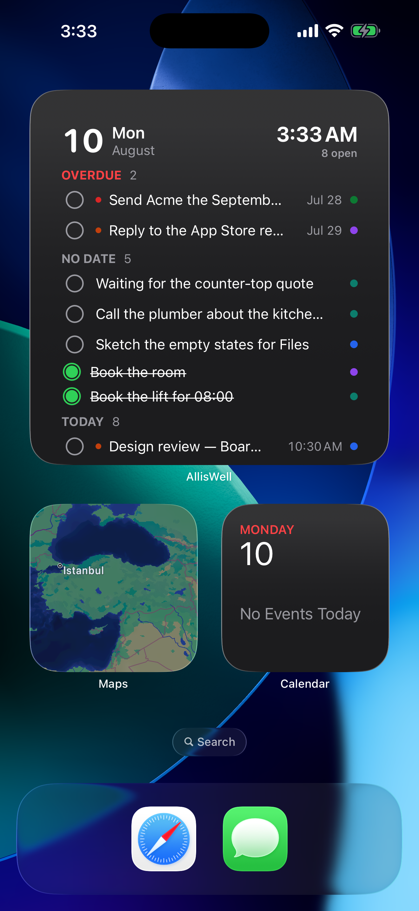
</p>

The widget is Home, at a glance — the same buckets (overdue · no date · today · this
week · this month), worked out by the app and drawn natively, so it never disagrees
with the list you open.

- **Tap the circle, the task is done** — without opening the app (iPhone and iPad on
  iOS 17+, Android; the Mac on macOS 14+ once its widget target is signed — below).
  It is an ordinary completion: it works offline and syncs like any other.
- **"+" opens the app on the new-task sheet**, the day already filled in.
- **One widget per project, if you like** — each widget can show everything or a
  single project (edit the widget on Apple platforms; long-press → reconfigure on
  Android).
- **The lock screen** (iPhone): the next task and when it is due, and how many tasks
  today still holds.
- **A clock that really ticks** in the header, in the date format you chose in the app.
- **Private widget and Compact widget** in *Settings › General › Widget*. Private
  shows "Private task" instead of every title — and the titles are never written for
  the widget at all, so they do not leave the app.
- Sizes: medium and large on iPhone, extra large on iPad and Mac, and a freely
  resizable widget on Android, which also turns the day over at midnight on its own.

**Self-hosting?** Widgets need nothing from your server: the app writes a small
snapshot for them from its local copy of your data, so every instance gets them as
they are. If you build and sign the app yourself under your own identifiers, the
iOS app and its widget extension must share one App Group (`group.com.alliswell.alliswell`
here — change it in both entitlements and in `widget_host.dart` together); Android
needs nothing; the macOS widget target is added by a script and signed once in Xcode
([`SETUP.md`](apps/app/macos/AllisWellWidgetMac/SETUP.md)). The whole design, with
the traps we measured on the way: [docs/WIDGETS.md](docs/WIDGETS.md).

</details>

<details>
<summary><h2>Every feature</h2></summary>

- **Fast capture** — a task in seconds, with or without a date; a dedicated **Inbox** keeps unplanned thoughts out of your day until you're ready. Plus **press-and-hold to talk**, **share any text or link** into the app, and **natural-language quick add, offline, in Turkish and English** — "tomorrow 9am pay rent #home p1" becomes a dated, tagged task, with the recognized words shown as chips you can undo (the optional ✨ AI parse still splits a sentence into several tasks).
- **Home, your way** — one chronological view (overdue · today · this week · next 30 days) with an Apple-style month calendar, **or** flip to a **Board (kanban)** with your own hideable, reorderable status columns and drag-to-move.
- **Projects** — colours, favourites, archiving, a Notion-style README note as the overview, and per-project Tasks / Notes / Files tabs.
- **Tags &amp; priorities** — type `#tags` inline (auto-create, colours, fold-matched suggestions) and set `none → urgent` priority. Checklists inside a task.
- **Alarm-grade reminders** — exact-minute delivery, **urgent alarms through Silent mode &amp; Focus**, a re-alert-until-acknowledged chain you can tune, snooze presets (5 m / 30 m / 1 h / tomorrow / custom) that each say when they'll ring, **mute one task's alarms** without completing it, your own ringtone, an **alarm log**, and a privacy mode that hides task content on the lock screen.
- **Recurring tasks that survive a short month** — see [Why people pick it](#why-people-pick-it).
- **Instant search** — case- **and accent-insensitive** across the Latin alphabets ("muller" finds _Müller_, "cafe" finds _café_), ranked title → tag → body, running locally over the on-device replica, so it works **offline**. The folding is the app's own, so results never depend on your database's collation.
- **Notes &amp; documents** — Markdown notes with live syntax while you type, a real GFM reading view (tables, task lists, footnotes, KaTeX, Mermaid), inline images, links to tasks and projects, pin/archive, card grid or list, and `.md` / PDF export. The engine is our own [markdown_forge](https://pub.dev/packages/markdown_forge) package (MIT) — extracted so any Flutter app can use it.
- **Calendar sync** — **two-way with Google Calendar**: your tasks become events, edits in Google come back, and your Google events show up on Home. On iPhone and Mac, tasks are also mirrored into **Apple Calendar** (one-way for now). Every task is on the calendar, and it is **not a setting**.
- **Attachments &amp; Files** — attach any file to tasks, notes and projects, plus a global **Files** section with nestable folders — stored in **Cloudflare R2 / any S3** via presigned URLs (the API never proxies your bytes).
- **Local-first realtime sync** — offline by default: a mutation outbox, a revision log, idempotent push with field-level last-write-wins, and a Socket.IO channel that fans changes to every device within a round-trip.
- **Finish things visibly** — a completed task stays on today's list, struck through and calm, until the next midnight; everything older lives in **Settings ▸ Completed**, a day-headed timeline you can scroll back through.
- **Delete like you expect** — swipe a row from the right, it half-opens, and the red **Delete** is what deletes. Tasks, notes, projects and files, with an **Undo** that works by not having written anything yet.
- **Quick access** — a personal shortcut list for the projects, tasks, notes, folders, files and links you actually live in, with your own emoji, colour and order. A **sidebar section** on desktop and web, a popover on narrow windows, and a **draggable floating button** on phones. Yours alone: shortcuts never leak to other members of a shared workspace.
- **AI, on your terms (optional)** — use it from the Claude or ChatGPT you already pay for ([above](#use-it-from-claude-or-chatgpt)), or bring your own key in the app: Anthropic, OpenAI, Gemini, OpenRouter or a local Ollama. Off by default; every proposed task waits for your tap.
- **Home-screen widgets** — iPhone, iPad, Android and (one signing step away) Mac widgets that mirror your Home buckets, carry the **system clock and how many tasks today actually holds** in the header, complete a task with one tap, follow one project if you want them to, and sit on the iPhone lock screen — see [Widgets](#widgets).
- **Sign in the way you already do** — e-mail and password, **Continue with Google**, or **Continue with Apple**. The provider proves who you are; **AllisWell's own database still owns the account**, so a self-hosted instance works the same way — or drops social sign-in entirely and keeps passwords. [How it works →](docs/adr/0026-social-sign-in.md)
- **Localisation** — ships in English and Turkish, auto-detected from your system; adding a language is dropping in one JSON file.
- **Self-hosted &amp; private** — your MySQL, your server, a four-step install. Free for personal use ([licence](#-licence--commercial-use)).

</details>

## Enterprise edition

Everything above is the free edition, and it is built for one person's work. **AllisWell
Enterprise** is a separate, commercially licensed edition for organisations where work is
filed between departments rather than kept on one list:

- **Teams on their own subdomains** — one instance, several organisations, isolated on the
  server rather than in the interface.
- **Permissions and units** — named permissions that roles are assembled from, and a unit
  per department, workshop or site, with explicit sharing between them.
- **A service desk** — a service catalogue routed to units, tickets that stay distinct from
  tasks, SLA targets that run on a shift-aware business calendar, and health checks that
  open an incident when a service goes down.
- **A public request portal** — a request form at a public URL, with expiry, revocation and
  quotas, for the people who should not have accounts.
- **Meeting recordings that become work** — a speaker-separated note with the decisions
  pulled out, and a decision that turns into a ticket.

It runs in the cloud under your organisation's own address, or on your own servers exactly
like the rest of AllisWell: your hardware, your database, no request leaving the building
unless you decide it should.

**→ [What the Enterprise edition includes](https://alliswell.space/enterprise)**
&nbsp;·&nbsp; **[Türkçe](https://alliswell.space/enterprise/tr)**
&nbsp;·&nbsp; [info@bubiapps.com](mailto:info@bubiapps.com)

It does not change the free edition in either direction — this repository stays under
PolyForm Noncommercial, and Enterprise is used under a separate written agreement. The
section below is the rule for both.

<!-- GitHub keeps the emoji's invisible U+FE0F in the heading's slug, and the docs still link this old slug; this name is what every #-licence--commercial-use link lands on. -->
<a name="-licence--commercial-use"></a>

## Licence and commercial use

**AllisWell is free for you, and not free for your employer.** That is the whole
rule; everything below is detail.

The source is public and it always will be. You can read it, fork it, change it,
and run your own instance on your own machine forever without paying anyone or
asking anyone. What you cannot do is take it into a business — resell it, offer
it as a service, or run it as part of a commercial operation.

| You are…                                                                      |             Free?             |
| ----------------------------------------------------------------------------- | :---------------------------: |
| A person, using it for your own life                                          |            ✅ Free            |
| Self-hosting your own instance at home or on your own VPS                     |            ✅ Free            |
| Studying it, forking it, submitting a fix, building on it as a hobby          |            ✅ Free            |
| A charity, school, university, public research body or government institution |            ✅ Free            |
| A company running it for your team, at any size                               | ❌ Needs a commercial licence |
| Reselling it, or offering it to others as a hosted service                    | ❌ Needs a commercial licence |

**Enterprise, or anything commercial → [info@bubiapps.com](mailto:info@bubiapps.com).**
What the Enterprise edition actually adds is one section up, and in
[alliswell.space/enterprise](https://alliswell.space/enterprise); the licence terms are
also in [docs/ENTERPRISE.md](docs/ENTERPRISE.md).
Commercial licences exist, they are not expensive, and they come with the
self-hosting support the free tier does not.

**Why this and not AGPL.** AllisWell used to be AGPL-3.0, and AGPL would have let
a competitor host the whole product commercially and comply merely by publishing
their changes. This is a single-maintainer product whose revenue is the hosted
service at [alliswell.space](https://alliswell.space) and the app stores — so the
licence now protects exactly that, and nothing else. The full reasoning, the
alternatives that were weighed (FSL, Elastic License, AGPL + commercial
exception), and the consequences are in
**[ADR-0024](docs/adr/0024-license-polyform-noncommercial.md)**.

**Being straight about the label.** PolyForm Noncommercial is **source-available**,
not OSI "open source" — it discriminates against commercial use, which the Open
Source Definition forbids. The repo used to say "open source" everywhere; it now
says source-available, because the other word would be untrue.

**If you already have v0.9.0 or earlier**, you have it under AGPL-3.0 and you
keep those rights for that copy. A licence granted cannot be taken back. These
terms apply from **v1.0.0**.

<details>
<summary><b>Licence in three questions</b></summary>

- **On my homelab, for my own life?** Free.
- **For a charity, school, university or public institution?** Free.
- **Inside a company, or as a service for other people?** That needs a commercial licence:
  [info@bubiapps.com](mailto:info@bubiapps.com).

GitHub lists the licence as "Other" because PolyForm Noncommercial is not one of the licences
it recognises. The text is in [LICENSE](LICENSE).

</details>

## Contributing

Bug reports, ideas and pull requests are welcome; please open an
[issue](https://github.com/mahirozdin/alliswell/issues) before a large change. Building from
source, the architecture, the commands and every document:
**[docs/development/README.md](docs/development/README.md)**.

**Translations** are especially welcome and need no Dart: copy
`apps/app/assets/i18n/en.json` to `<code>.json`, translate the values, and
register the locale — see [CONTRIBUTING.md](CONTRIBUTING.md#translating-adding-a-language).

**How this repo is built.** Much of the code is written by AI coding agents working from
written rules, tests and review; how that works is in
[docs/development/README.md](docs/development/README.md#built-to-be-developed-by-ai-agents).

**Licence:** [PolyForm Noncommercial 1.0.0](LICENSE) — see
[Licence & commercial use](#-licence--commercial-use) above. Contributions are
accepted under the same terms.

---

<div align="center">

**[alliswell.space](https://alliswell.space)** &nbsp;·&nbsp;
**[Open the app](https://alliswell.space/app)** &nbsp;·&nbsp;
**[Google Play](https://play.google.com/store/apps/details?id=com.alliswell.alliswell)** &nbsp;·&nbsp;
**[App Store](https://apps.apple.com/app/alliswell-todo-and-reminders/id6794964494)** &nbsp;·&nbsp;
**[Star this repo](https://github.com/mahirozdin/alliswell)**

<sub>

**AllisWell**: source-available, self-hosted to-do, reminder and notes app · alternative to Todoist, Things 3, TickTick, Apple Reminders and Notion · two-way Google Calendar sync and an Apple Calendar mirror · offline-first · Flutter (iOS, Android, Web, macOS, Windows, Linux) · Node.js + MySQL.

</sub>
</div>
